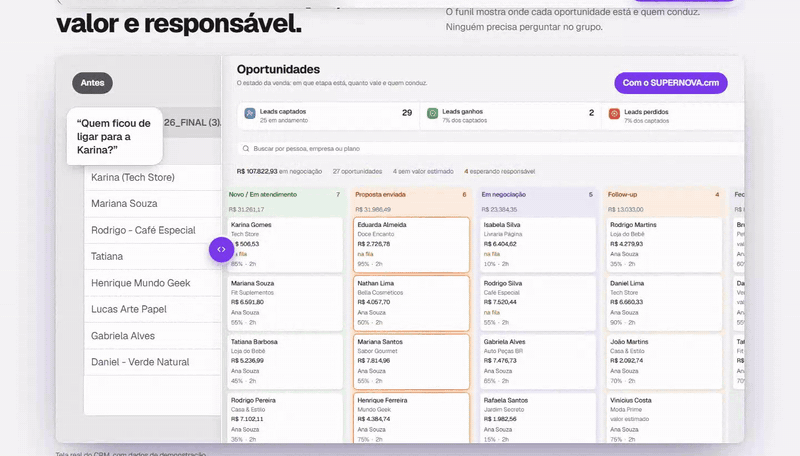
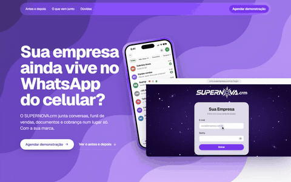

# SUPERNOVA.crm · Landing page

Página de venda do SUPERNOVA.crm. HTML estático, sem build: abra `index.html` ou sirva a pasta em qualquer hospedagem estática.

## Como ela é

**Abertura:** login simulado com a logo e o fundo animados do produto; depois, um cursor navega pelas telas reais do CRM.

<table><tr>
<td width="34%"><strong>Celular:</strong> o “antes”, com mensagens chegando sem parar.  </td>
<td><strong>Antes e depois:</strong> a régua compara o jeito de hoje com a tela real do CRM.  </td>
</tr></table>

**A página inteira** (acelerada):

## Arquivos

- `index.html`: a página, com CSS e JS embutidos.
- `assets/telas/`: recortes de telas reais do CRM, com dados de demonstração. Cada imagem tem a origem registrada no arquivo `.json` ao lado.
- `assets/ondas.js`, `assets/logo.js`, `assets/universo.js`: ondas da marca, logo animada e fundo do login, gerados a partir dos componentes do CRM. Não edite à mão.
- Contato: o número de WhatsApp dos botões fica em `CONTATO.whatsapp`, no início do `<script>` de `index.html`.
